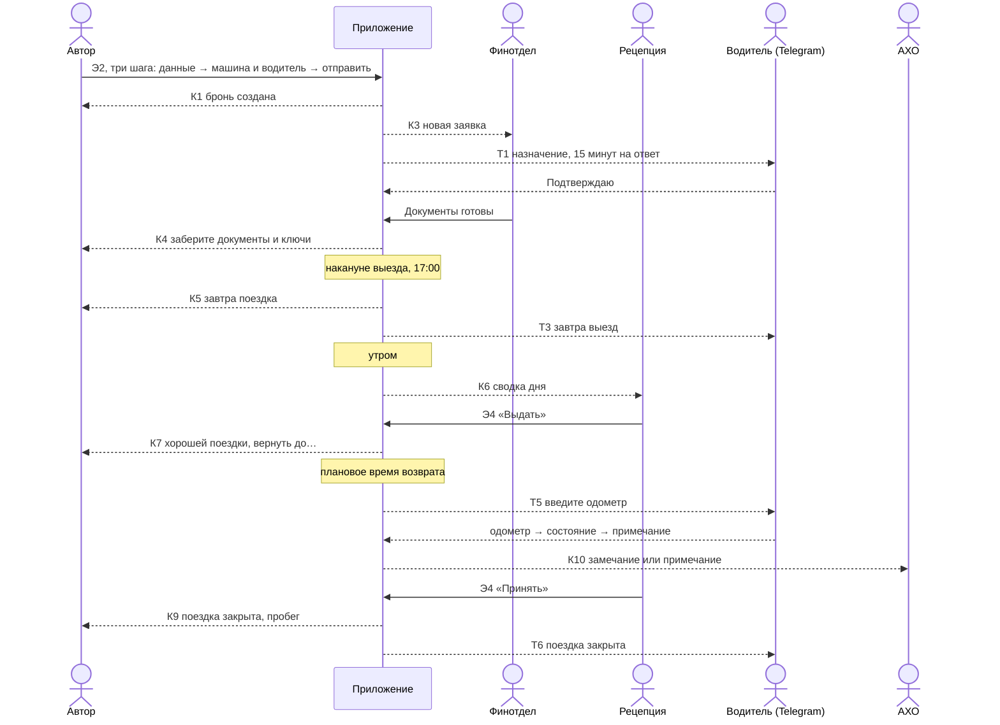
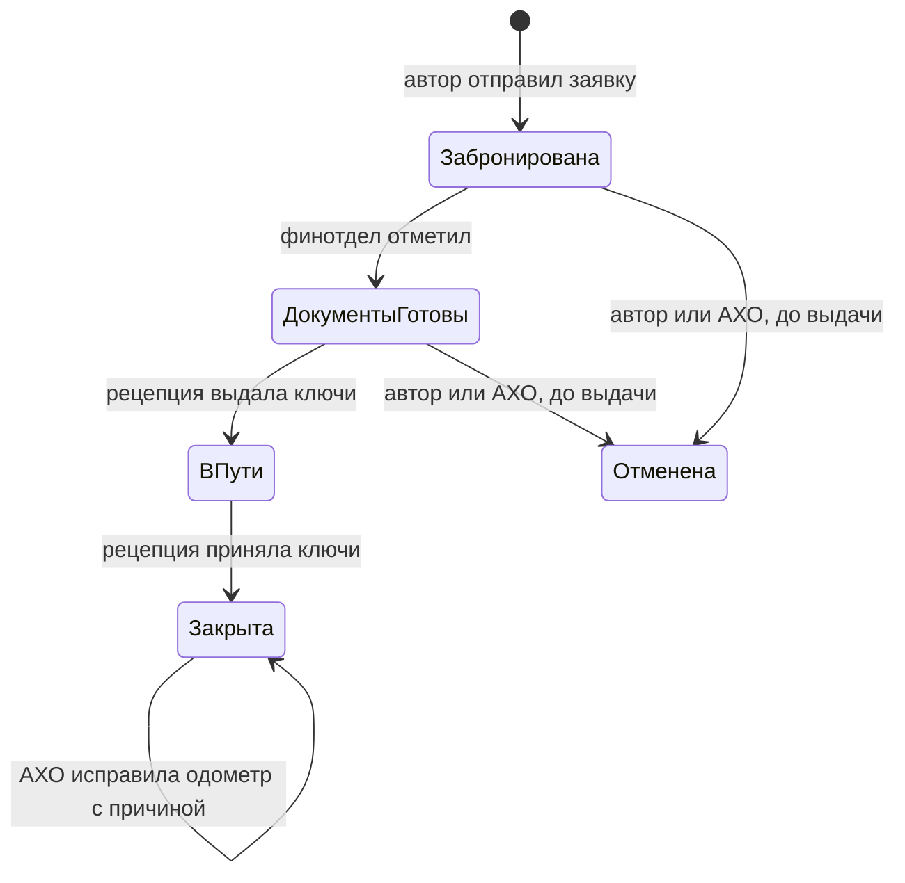
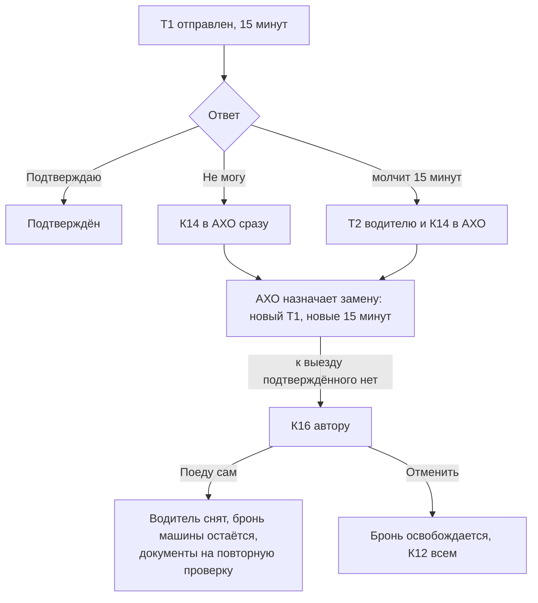
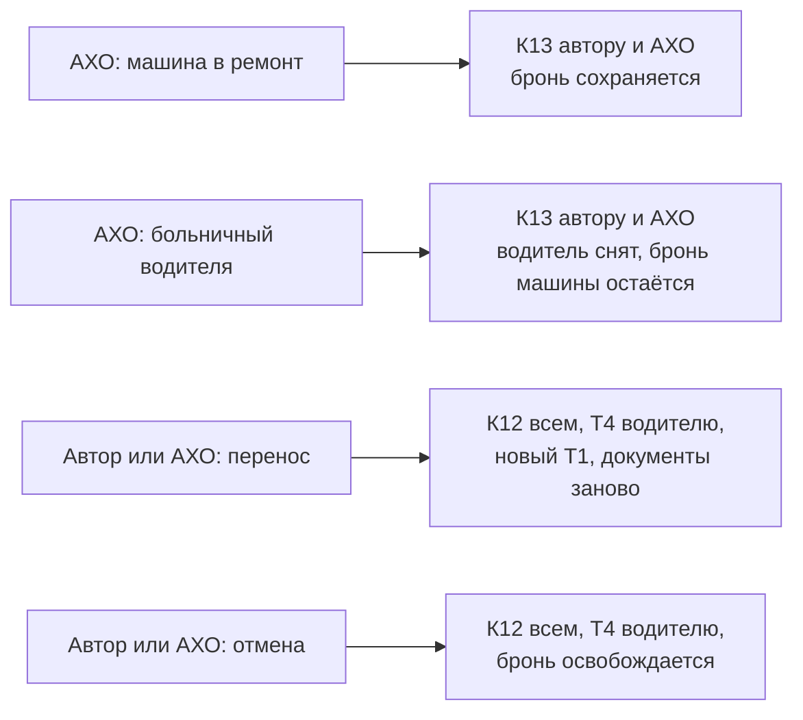

# Проверка вручную: ЭНЭКА.Командировки

Что должно происходить, в каком порядке, и что проверить. Сверено с
`docs/source/ЭНЭКА.Командировки. Этап 1.md`.

Обозначения: **К1–К16** — карточки бота в Teams, **Т1–Т6** — сообщения бота в
Telegram, **Э1–Э9** — экраны вкладки.

---

## Часть 1. Как это должно работать

### Путь поездки целиком



Поездка **без водителя** идёт так же, только без Т1, Т3, Т5 и Т6, а в
плановое время возврата автору приходит **К8** с полями одометра прямо в
карточке.

### Состояния поездки



Перенести и отменить можно **только до выдачи ключей**. После выдачи остаётся
один путь: принять ключи.

### Подтверждение водителя



### Что ломает готовую бронь



### Кто что видит

| Роль | Экраны | Сообщения |
|---|---|---|
| Любой сотрудник | Э1 Мои поездки, Э2 Новая поездка, Э3 Карточка | К1, К2, К4, К5, К7, К8, К9, К12, К13, К16 |
| Рецепция | + Э4 Рецепция | К6 |
| Финотдел | + Э5 Документы | К3 |
| АХО | + Э4, Э5, Э6 Календарь, Э7 История, Э8 Машины, Э9 Водители | К10, К11, К13, К14, К15 |
| Водитель | только бот в Telegram | Т1–Т6 |

### Правила, которые нельзя нарушить

| Правило | Где проверяется |
|---|---|
| Двойная бронь невозможна | ограничение базы, не интерфейс |
| Между бронями одной машины — не меньше 10 минут | то же; после фактического возврата считается от него |
| Поездку нельзя закрыть без показания одометра | «Принять» недоступно |
| Следующую выдачу нельзя оформить, пока не закрыта предыдущая | «Выдать» откажет с номером поездки |
| Начальный одометр = значение при прошлом возврате | снимок при выдаче ключей |
| Перенос и отмена — только до выдачи ключей | кнопки исчезают |
| Изменение заявки снимает «Документы готовы» | заявка снова в Э5 с отметкой «изменена» |
| Любое изменение попадает в журнал | Э3, раздел «Журнал» |

---

## Часть 2. Подготовка

Без этих трёх шагов половину проверить нечем.

### 1. Задеплоить последний коммит

Иначе проверяется код прошлой недели. Признак, что всё на месте: в меню семь
разделов и открывается `https://trips.eneca.by/privacy`.

### 2. Выдать себе роли рецепции и финотдела

```bash
node --env-file=.env.local scripts/grant-role.mjs Alexandra.Birilo@enecagroup.com reception
node --env-file=.env.local scripts/grant-role.mjs Alexandra.Birilo@enecagroup.com finance
```

Проверять одной учётной записью за всех — единственный способ, пока заказчик не
назвал людей от финотдела и рецепции.

### 3. Завести данные

| Что | Где | Зачем |
|---|---|---|
| Две машины | Э8 Машины | чтобы проверять буфер между бронями |
| Водитель на себя | Э9 Водители | «Выдать код» → ввести код боту |

Второй водитель не нужен: замену можно проверить, сняв первого.

---

## Часть 3. Сценарии

Каждый шаг опирается на предыдущий. Записывайте, что разошлось с ожиданием.

### Сценарий 1. Вход и роли

| Что сделать | Что должно быть |
|---|---|
| Открыть вкладку в Teams | Полоска разделов, справа имя и кружок с инициалами |
| Посмотреть разделы | Мои поездки, Календарь, Рецепция, Документы, Машины, Водители, История |
| Переключить тему Teams на тёмную | Вкладка перекрашивается **сразу**, без перезагрузки |
| Попросить коллегу без ролей открыть | У него **нет** полоски разделов вообще |

### Сценарий 2. Буфер 10 минут — самое важное

| Что сделать | Что должно быть |
|---|---|
| Создать заявку: завтра 09:00–11:00, машина А, без водителя | Приходит К1 и К3 |
| Начать вторую заявку: завтра 11:05–13:00 | Машина А **недоступна**, подпись «занята до 11:10» |
| Изменить время на 11:10–13:00 | Машина А доступна |
| Поставить возврат за 5 минут до чужого выезда | Тоже недоступна — буфер работает в обе стороны |

Если буфер не работает, останавливайтесь: это основа всего.

### Сценарий 3. Водитель: подтверждение и отказ

| Что сделать | Что должно быть |
|---|---|
| Создать заявку с водителем на себя | В Telegram **Т1**: номер, даты, маршрут, машина, пассажиры, кнопки |
| Нажать «Подтверждаю» | Кнопки исчезают, в тексте «Вы подтвердили поездку». В Э3 «подтверждён» |
| Создать вторую и нажать «Не могу» | Кнопки исчезают. В Teams приходит **К14** «водитель не подтвердил» |
| Открыть Э3 второй поездки | Статус водителя «отказался», в журнале запись |
| Нажать кнопку в Т1 повторно | Бот отвечает «На это назначение вы уже ответили» |

### Сценарий 4. Документы и выдача ключей

| Что сделать | Что должно быть |
|---|---|
| Открыть Э4 Рецепция до отметки документов | «Выдать» **недоступна**, при наведении — «Сначала финотдел готовит документы» |
| Э5 Документы → «Документы готовы» | Поездка уходит из очереди, автору приходит **К4** |
| Э4 → «Выдать» | Приходит **К7** со сроком возврата и одометром при выдаче |
| Попробовать выдать вторую поездку на ту же машину | Отказ: «Машина ещё в поездке #N. Сначала примите её» |
| Открыть Э3 | «Сейчас: ключи у вас — вернуть на рецепцию к плановому времени» |

### Сценарий 5. Возврат водителем через Telegram

| Что сделать | Что должно быть |
|---|---|
| В Telegram нажать «Мои поездки» | Список поездок и кнопка «Оформить возврат #N» |
| Нажать её | Бот просит одометр и называет начальное показание |
| Ввести число **меньше** начального | Отказ с объяснением. В Teams приходит **К11** |
| Ввести правильное | «Записал: … км, пробег … км», кнопки «Да» и «Есть замечание» |
| Нажать «Есть замечание» | Бот спрашивает, что с машиной |
| Написать «спускает заднее колесо» | «Спасибо, передал в АХО». В Teams приходит **К10** с кнопками |
| Э4 Рецепция | В возвратах видно показание, «Принять» стала доступна |
| «Принять» | Приходит **К9** с пробегом, в Telegram **Т6**. Статус «Закрыта» |

### Сценарий 6. Возврат автором без водителя

| Что сделать | Что должно быть |
|---|---|
| Поездка без водителя, ключи выданы, Э3 | Кнопка «Оформить возврат» |
| Заполнить одометр | Пробег считается **прямо в форме**, пока набираете |
| Отправить | Кнопка меняется на «Исправить показание» |
| Нажать «Исправить показание» | Поля подставлены прежними, написано, до какого момента можно |
| Э4 → «Принять» | Поездка закрыта, приходит **К9** |

Если в плановое время возврата автор ничего не сделал, ему приходит **К8** с
полями одометра прямо в карточке — её можно заполнить и отправить оттуда.

### Сценарий 7. Замечание и ремонт

| Что сделать | Что должно быть |
|---|---|
| Э8 Машины после возврата с замечанием | Под машиной строка «Замечание: …, дата · поездка #N, кто» |
| Нажать «В ремонт» | Машина «в ремонте», текст замечания стал причиной ремонта |
| Создать новую заявку | Эта машина в списке есть, но **недоступна**: «в ремонте: …» |
| Э8 → «Исправлено» | Машина снова исправна |
| То же из карточки **К10** в Teams | Работает так же, карточка превращается в итог |

### Сценарий 8. Перенос и отмена

| Что сделать | Что должно быть |
|---|---|
| Э3 поездки до выдачи ключей | Кнопки «Перенести» и «Отменить» |
| «Перенести» | Форма перечисляет последствия: проверка заново, документы заново, новый запрос водителю |
| Перенести на занятое время | Отказ: «На это время машина занята» |
| Перенести на свободное | Приходит **К12**, новый **Т1** водителю, документы снова в Э5 с отметкой «изменена» |
| «Отменить» | Спрашивает подтверждение **своим** диалогом, не браузерным |
| Подтвердить отмену | Приходит **К12**, машина освободилась, статус «Отменена» |
| Создать заявку на освободившееся время | Проходит |
| Поездка с выданными ключами | Кнопок «Перенести» и «Отменить» **нет** |

### Сценарий 9. Что ломает бронь

| Что сделать | Что должно быть |
|---|---|
| Создать заявку на завтра с водителем | — |
| Э9 Водители → «Отметить период» на эти даты, болезнь | Приходит **К13**. В Э3 водителя больше нет, бронь машины осталась |
| Э8 Машины → «В ремонт» машину с будущей бронью | Приходит **К13** «машина в ремонте с …» |

### Сценарий 10. Календарь и история

| Что сделать | Что должно быть |
|---|---|
| Э6 Календарь, неделя | Строки — машины и водители, в ячейках номера поездок, «ремонт», «болезнь» |
| Нажать на номер поездки | Открывается её карточка |
| Переключить на «Месяц» | Таблица прокручивается вбок, столбцы не сжимаются |
| Поездка с 23:00 до 01:00 | Занимает **двое** суток |
| Э7 История за месяц | Закрытые и отменённые, пробег, примечания, сумма внизу |
| Фильтр по машине и сотруднику | Список сужается |

### Сценарий 11. Напоминания — по часам

| Что сделать | Что должно быть |
|---|---|
| Создать заявку с выездом **завтра**, до 17:00 | Ничего не приходит — это правильно |
| После 17:00 по Минску | Приходят **К5** автору и **Т3** водителю |
| Утром при наличии выдач | Приходит **К6** сводка рецепции |
| Поездка с несданными ключами, после 8:00 | Приходит **К15** автору и АХО, раз в день |

Напоминания проверяет задача раз в минуту. Если ничего не пришло — посмотрите
Vercel → Logs, фильтр `/api/jobs/tick`: там должны быть вызовы каждую минуту.

### Сценарий 12. Исправление одометра после закрытия

| Что сделать | Что должно быть |
|---|---|
| Э3 закрытой поездки, вы АХО | Кнопка «Исправить показание» |
| Нажать, оставить причину пустой | Отказ: причина обязательна |
| Ввести новое значение и причину | Приходит **К11** с прежним и новым значением |
| Э3, журнал | Запись об исправлении |
| Если после этой поездки были другие | В К11 предупреждение: их показания **не** изменены |

---

## Часть 4. Что сейчас работать не может

Чтобы не искать несуществующие поломки.

| Что | Почему |
|---|---|
| К3 финотделу и К6 рецепции не придут никому | роли не выданы никому, кроме вас в шаге подготовки |
| Участник без установленного приложения не получит К2 | Teams не даёт боту написать первым; снимется публикацией в каталоге |
| Выгрузка истории в Excel | в требованиях «желательно», перенесена в этап 2 |
| Отчёт загрузки в процентах, команда «Помощь» | то же |
| Сообщения настоящим водителям | ждём согласия Павла Соколова на передачу данных через Telegram |

---

## Часть 5. Как записывать

Для каждого расхождения достаточно четырёх строк:

```
Сценарий:   4, выдача ключей
Что делала: Э4 → «Выдать» по поездке #31
Ожидала:    К7 со сроком возврата
Получила:   ничего, кнопка осталась активной
```

Снимок экрана помогает, но текст ошибки важнее: сообщения в приложении
написаны по-разному нарочно, и по формулировке видно, какое звено отказало.
