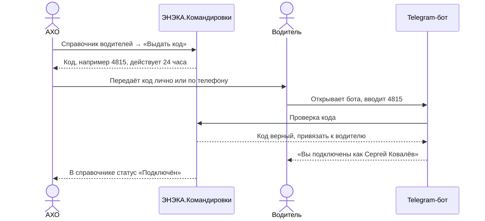
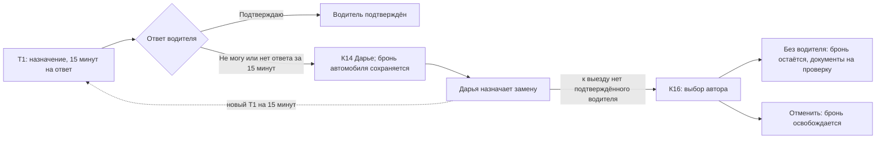
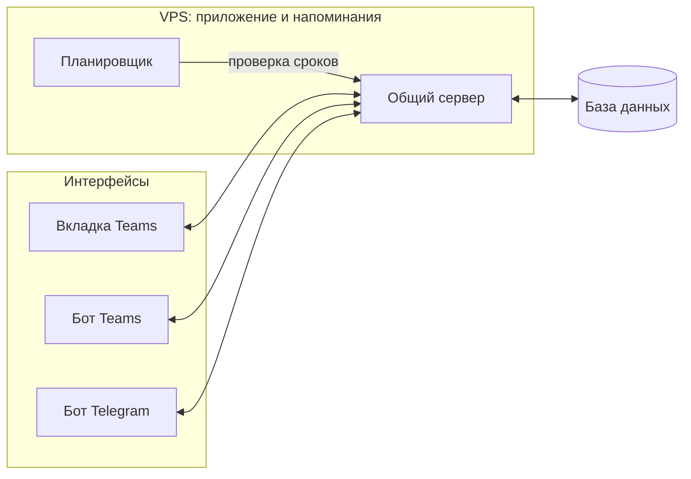
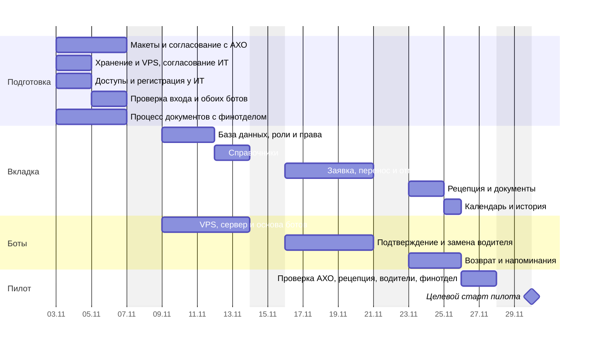

# ЭНЭКА.Командировки. Этап 1

> Версия 3 от 04.11.2026.
> Целевой старт пилота — 30.11.2026, с учётом доступов ИТ и согласования с финотделом.
> На согласование: состав этапа, экраны вкладки, сообщения ботов, порядок работ и сроки.
> Основание: концепция «ЭНЭКА.Командировки» с доработками по итогам обсуждения с АХО.

## 1. Что делаем в этапе 1

Весь путь поездки от заявки до закрытия: заявка и бронь, документы, выдача и возврат ключей, одометр, примечания, календарь и история для АХО. Для водителей — отдельный бот в Telegram.

**Обязательно** (необходимо для запуска):
- вход через Entra ID, роли АХО, Рецепция, Финотдел;
- справочники машин и водителей, отметки «В ремонте» и «Недоступен»;
- заявка, проверка полей, бронь без пересечений с интервалом 10 минут между бронями одного автомобиля; перенос и отмена — в карточке Э3;
- очередь финотдела с кнопкой «Документы готовы»;
- экран рецепции: выдача и приём ключей, досрочный возврат и просроченные незакрытые поездки;
- карточки Teams-бота по всему пути поездки;
- Telegram-бот водителя: подключение, поездка, подтверждение, возврат;
- одометр, состояние и примечание при возврате, расчёт пробега, исправление показаний с сохранением истории;
- календарь броней и история поездок для АХО;
- напоминания: накануне выезда, о возврате, о незакрытой поездке.

**Желательно** (при нехватке времени переносим в этап 2):
- выгрузка истории в Excel;
- отчёт о загрузке машин и водителей в процентах (сама загрузка видна в календаре);
- команда «Помощь» в ботах.

**Не входит в этап 1:** PDF-документы, путевые листы и топливо, зарубежные поездки, интеграции с учётными системами, согласование руководителем (если понадобится — этап 2).

## 2. Кто пользуется

| Кто | Где | Основные экраны и сообщения |
|---|---|---|
| Сотрудники | Teams | «Мои поездки», «Новая поездка», карточки бота |
| Виктория (рецепция) | Teams | «Рецепция: сегодня», карточки выдачи и возврата |
| Финотдел (кто — уточняется) | Teams | «Очередь документов», карточка новой заявки |
| Дарья Шубина (АХО) | Teams | «Календарь», «История», «Машины», «Водители», карточки замечаний |
| Два водителя | Telegram | сообщения бота о поездках |

### Права участников

| Роль | Доступные действия |
|---|---|
| Автор | Создать заявку; просматривать свои поездки; переносить и отменять до выдачи ключей; оформить возврат поездки без водителя |
| Участник | Просматривать поездку, получать уведомления; изменение заявки недоступно |
| АХО | Управлять бронями; переносить и отменять до выдачи ключей; назначать и заменять водителей; вести справочники; исправлять одометр |
| Рецепция | Выдавать и принимать ключи, видеть возвраты и просроченные поездки |
| Финотдел | Готовить и повторно проверять документы, отмечать «Документы готовы» |
| Водитель | Подтвердить назначение или отказаться; оформить возврат через Telegram; сообщить о недоступности Дарье |

## 3. Экраны вкладки в Teams

| № | Экран | Кто видит | Что на экране |
|---|---|---|---|
| Э1 | Мои поездки | все | список своих заявок и заявок, в которых сотрудник указан участником; статус каждой; кнопка «Новая поездка» |
| Э2 | Новая поездка | все | три шага: данные поездки → выбор машины и водителя → проверка и отправка |
| Э3 | Карточка поездки | автор, участники, АХО | все данные заявки, статус подтверждения водителя, журнал событий; автору и АХО до выдачи ключей — «Перенести», «Отменить»; участникам — просмотр |
| Э4 | Рецепция: сегодня | рецепция, АХО | выдачи и возвраты на сегодня, досрочные возвраты и все просроченные незакрытые поездки; кнопки «Выдать», «Принять»; статус «Ждём одометр» |
| Э5 | Очередь документов | финотдел, АХО | новые и изменённые заявки с данными для документов; перечень изменений; кнопка «Документы готовы» |
| Э6 | Календарь | АХО | машины и водители по дням; брони, ремонт, недоступность водителей |
| Э7 | История поездок | АХО | поездки за период с фильтрами; пробег; примечания; выгрузка в Excel (желательно) |
| Э8 | Машины | АХО | справочник машин: номер, модель, текущий одометр, статус; список замечаний и примечаний, отметка «Исправлено» |
| Э9 | Водители | АХО | справочник водителей: периоды недоступности, статус подключения к Telegram, кнопка «Выдать код» |

На рисунках ниже — условные данные для примера.

### Э1. Мои поездки

```
┌─ Мои поездки───────────────────────────────────────────────┐
│                                      [ + Новая поездка ]   │
│ #127  05–06.11  Минск → Гомель       Документы готовы      │
│       Octavia 1234 AB-7, вод. Ковалёв          [ Открыть ] │
│ #131  12.11     Минск → Брест        Забронирована         │
│       Passat 5678 AB-7, без водителя           [ Открыть ] │
│ #119  28–29.10  Минск → Витебск      Закрыта, 548 км       │
│       я участник (автор — Козлов А.)           [ Открыть ] │
└────────────────────────────────────────────────────────────┘
```

### Э2. Новая поездка

```
┌─ Новая поездка ─────────────────────────────── шаг 1 из 3──┐
│ Выезд        [05.11.2026] [07:00]                          │
│ Возврат      [06.11.2026] [19:00]                          │
│ Маршрут      [Минск → Гомель → Минск            ]          │
│ Участники    [Сидорова Ольга ×] [+ добавить]               │
│ Договор      [45/2026        ]                             │
│ Цель         [Авторский надзор на объекте       ]          │
│ Нужен водитель   (•) да   ( ) нет                          │
│                                            [ Далее → ]     │
└────────────────────────────────────────────────────────────┘

┌─ Новая поездка ─────────────────────────────── шаг 2 из 3──┐
│ Свободно 05.11 07:00 – 06.11 19:00                         │
│ Машина    (•) Škoda Octavia 1234 AB-7                      │
│           ( ) VW Passat 5678 AB-7 — занят до 05.11 12:00   │
│ Водитель  (•) Сергей Ковалёв                               │
│           ( ) Андрей Лис — недоступен (болезнь)            │
│                              [ ← Назад ]  [ Далее → ]      │
└────────────────────────────────────────────────────────────┘
```

| Проверка при отправке | Результат |
|---|---|
| Шаг 3: данные заявки и кнопка «Отправить» | Повторная проверка доступности машины и водителя |
| Между бронями одного автомобиля — не менее 10 минут | После окончания в 12:00 следующая бронь возможна с 12:10 |
| Машину заняли во время заполнения | «Эту машину только что забронировали»; возврат к шагу 2 |


### Э3. Карточка поездки

```
┌─ Поездка #127 ──────────────────────── Документы готовы────┐
│ 05.11 07:00 – 06.11 19:00    Минск → Гомель → Минск        │
│ Участники: Петров И. (автор), Сидорова О.                  │
│ Договор 45/2026 · Авторский надзор на объекте              │
│ Машина: Octavia 1234 AB-7 · Водитель: Ковалёв С.           │
│ Подтверждение водителя: подтверждён                        │
│                                                            │
│ Журнал                                                     │
│ 28.10 10:14  Петров И. — бронь создана                     │
│ 28.10 10:24  Ковалёв С. — водитель подтвердил              │
│ 30.10 15:20  Финотдел — документы готовы                   │
│                                                            │
│                            [ Перенести ]  [ Отменить ]     │
└────────────────────────────────────────────────────────────┘
```

### Действия с заявкой

| Действие | Проверка | Результат и уведомления |
|---|---|---|
| «Перенести» — автор или АХО, до выдачи ключей | Новые даты и время; доступность автомобиля и водителя; буфер 10 минут | При конфликте прежняя бронь остаётся. При успехе старое время освобождается, новое бронируется; уведомления автору, участникам, водителю, рецепции и финотделу (К12, Т4) |
| Изменить время или назначенного водителя | Новое подтверждение водителя за 15 минут | Новый запрос Т1; документы на повторную проверку в Э5 |
| «Отменить» — автор или АХО, до выдачи ключей | Подтверждение отмены | Автомобиль и водитель освобождаются, будущие напоминания прекращаются. Статус «Отменена», запись в журнале, уведомления К12 и Т4 |
| После выдачи ключей | Перенос и отмена недоступны | Автор поездки без водителя видит «Оформить возврат»; водитель начинает возврат в Telegram |

Любое изменение сохраняется в журнале. Участники видят карточку без кнопок изменения заявки.

### Э4. Рецепция: сегодня

```
┌─ Рецепция · четверг, 05.11──────────────────────────────────┐
│ ВЫДАЧА                                                      │
│ 07:00  #127 Octavia 1234 AB-7  Петров / вод. Ковалёв        │
│        Документы: готовы                    [ Выдать ]      │
│ ВОЗВРАТ                                                     │
│ 12:00  #118 Passat 5678 AB-7   Козлов / без водителя        │
│        Одометр: ждём от Козлова             [ Принять ]     │
│                                              недоступно     │
│ ДОСРОЧНЫЙ ВОЗВРАТ                                           │
│ #132 Passat — одометр получен                [ Принять ]    │
│ ПРОСРОЧЕННЫЕ                                                │
│ #116 Octavia 9012 · Петров — возврат 04.11 19:00            │
│      Ключи не сданы · Одометр: ожидается                    │
└─────────────────────────────────────────────────────────────┘
```

| Сценарий возврата | Действия | Результат |
|---|---|---|
| Обычный или досрочный | Без водителя — автор нажимает «Оформить возврат» в Teams; с водителем — водитель начинает возврат из «Моих поездок» в Telegram. Вводятся одометр, состояние, примечание | Возврат появляется на экране рецепции; ждать планового времени не требуется |
| Приём ключей | После корректного одометра доступно «Принять»; рецепция подтверждает приём | Фактическое время возврата, закрытие поездки, освобождение оставшейся части брони; следующая бронь — не раньше чем через 10 минут после фактического возврата, с учётом других броней. Повторные запросы возврата прекращаются |
| Просрочено | Плановое время прошло, поездка не закрыта | Отдельный список всех незакрытых поездок, включая предыдущие дни: автомобиль, ответственный, срок возврата, состояние одометра и ключей |


### Э5. Очередь документов

```
┌─ Очередь документов────────────────────────────────────────┐
│ #127  05–06.11  Минск → Гомель                             │
│       Петров И., Сидорова О. · договор 45/2026             │
│       Изменена — требуется проверка документов             │
│       Изменились даты                [ Документы готовы ]  │
│ #131  12.11     Минск → Брест                              │
│       Петров И. · договор 51/2026                          │
│       Цель: сдача документации       [ Документы готовы ]  │
└────────────────────────────────────────────────────────────┘
```

| Изменение заявки | Документы и очередь Э5 | Уведомление |
|---|---|---|
| Даты, маршрут, участники, договор, цель, автомобиль или водитель | Отметка «Документы готовы» снимается; прежний комплект неактуален. В очереди — «Изменена — требуется проверка документов» и перечень изменений | Финотдел получает актуальную карточку К12; проверяет и при необходимости переоформляет документы, повторно подтверждает готовность |
| Отмена | Подготовка прекращается; заявка исключается из активной очереди; история сохраняется | К12 финотделу |

### Э6. Календарь

```
Календарь · ноябрь 2026                     [Неделя] [Месяц]
                   Пн 02    Вт 03    Ср 04    Чт 05    Пт 06
Octavia 1234          —        —        —      #127     #127
Passat 5678       ремонт   ремонт     #118     #118        —
Ковалёв С.            —        —        —      #127     #127
Лис А.               —        —   болезнь  болезнь  болезнь
```

Бронь #127: 05.11 07:00 — 06.11 19:00; #118: 04.11 — 05.11 12:00. В ячейках — занятость по дням; при выборе — точное время. Буфер проверяется по правилу Э2.

### Э7. История поездок

```
┌─ История поездок ─────────────────── [ Выгрузить в Excel ]─┐
│ Период [01.11–30.11]  Машина [все ▾]  Сотрудник [все ▾]    │
│                                                            │
│ Дата      Машина     Сотрудник  Водитель  Маршрут    Км    │
│ 04–05.11  Passat     Козлов А.  —         Брест      702   │
│ 05–06.11  Octavia    Петров И.  Ковалёв   Гомель     636 * │
│                                                            │
│ * есть примечание: «оставили папку с чертежами»            │
└────────────────────────────────────────────────────────────┘
```

Кнопка «Выгрузить в Excel» — из списка «Желательно».

### Э8. Машины

```
┌─ Машины ───────────────────────────────── [ + Добавить ]───┐
│ Škoda Octavia 1234 AB-7   одометр 85 136   ● исправна      │
│   Примечание: «оставили папку с чертежами», 06.11          │
│                                          [ Изменить ]      │
│ VW Passat 5678 AB-7       одометр 62 410   ● в ремонте     │
│   Замечание: «спускает заднее колесо», 05.11               │
│                       [ Исправлено ]     [ Изменить ]      │
└────────────────────────────────────────────────────────────┘
```

**Исправление одометра**

| Случай | Кто и что делает | Результат |
|---|---|---|
| Значение меньше начального | Введший получает объяснение и повторяет ввод | Ошибочное значение не сохраняется; К11 для АХО |
| Ошибка до закрытия поездки | Отправитель исправляет своё значение | Пробег пересчитывается; «Принять» доступно только при корректном одометре |
| Ошибка после закрытия | АХО вводит новое значение и обязательную причину | Сохраняются прежнее и новое значения, кто и когда исправил; пробег пересчитывается. Если затронуты последующие поездки — предупреждение АХО; их значения автоматически не меняются |

### Э9. Водители

```
┌─ Водители──────────────────────────────────────────────────┐
│ Сергей Ковалёв   Telegram: подключён       [ Выдать код ]  │
│   Недоступен: —                    [ + Отметить период ]   │
│                                                            │
│ Андрей Лис       Telegram: подключён       [ Выдать код ]  │
│   Недоступен: 04.11 – 06.11, болезнь         [ Изменить ]  │
└────────────────────────────────────────────────────────────┘

┌─ Отметить недоступность: Андрей Лис────────────────────────┐
│ С     [04.11.2026]      По  [06.11.2026]                   │
│ Причина   (•) болезнь  ( ) отпуск  ( ) другое              │
│                                       [ Сохранить ]        │
└────────────────────────────────────────────────────────────┘
```

Больничные и отпуска водителей вносит АХО. Водитель сообщает о болезни Дарье Шубиной, в Telegram-боте он сам её не отмечает. После сохранения:
- водитель не предлагается в новых заявках на эти даты;
- в календаре Э6 появляется полоса «болезнь»;
- если на эти даты у водителя есть предстоящие поездки, назначение на них снимается; брони автомобилей сохраняются; авторы и АХО получают сообщение К13, у АХО под ним кнопка «Назначить водителя»;
- водитель получает в Telegram сообщение Т4 о снятии с поездки.

Если водитель вернулся раньше, АХО сокращает период кнопкой «Изменить».

## 4. Карточки бота в Teams

Карточка — сообщение бота в личном чате Teams с кнопками под текстом.

| № | Кому | Когда | Что в карточке | Кнопки |
|---|---|---|---|---|
| К1 | автору | бронь создана | номер, даты, маршрут, машина, водитель | Открыть, Отменить |
| К2 | участникам | добавлен в поездку | кто едет, куда, когда | Открыть |
| К3 | финотделу | новая заявка | участники, даты, маршрут, договор, цель | Открыть, Документы готовы |
| К4 | автору | документы готовы | «Заберите документы и ключи на рецепции перед выездом» | Открыть |
| К5 | автору | накануне выезда, 17:00 | время выезда, машина, водитель, «ключи на рецепции» | Открыть |
| К6 | рецепции | каждое утро | выдачи и возвраты на сегодня, просроченные незакрытые поездки | Открыть экран рецепции |
| К7 | автору | ключи выданы | «Хорошей поездки. Вернуть ключи до 06.11 19:00» | — |
| К8 | автору поездки без водителя | плановое время возврата или начало досрочного возврата | поле «Одометр» (с подсказкой начального), «Всё в порядке?», поле «Примечание» | Да, Есть замечание, Отправить |
| К9 | автору | поездка закрыта | пробег, итог | — |
| К10 | АХО | замечание или примечание при возврате | машина, поездка, кто написал, текст | Принято (примечание); В ремонт, Исправлено (замечание) |
| К11 | АХО | показание меньше начального или запрос исправления после закрытия | машина, поездка, начальное и введённое значения, кто ввёл; при исправлении — прежнее значение и причина | Открыть |
| К12 | автору, участникам, водителю, рецепции и финотделу (водителю — Т4) | поездка отменена, перенесена или изменены данные для документов | что изменилось; статус документов и необходимость повторной проверки | Открыть |
| К13 | автору и АХО | бронь затронута: машина в ремонте или водитель недоступен | что случилось, какие даты | Выбрать другую (автору), Назначить водителя (АХО) |
| К14 | Дарье Шубиной (АХО) | сразу после «Не могу» или через 15 минут без подтверждения | поездка, водитель, отказ или отсутствие подтверждения; бронь автомобиля сохранена | Назначить водителя |
| К15 | автору и АХО | ключи не сданы до утра | поездка, машина, плановое время возврата | Открыть |
| К16 | автору | к плановому времени выезда нет подтверждённого водителя | выбрать поездку без водителя или отмену; до решения бронь сохраняется | Без водителя, Отменить |

| Состояние карточки | Поведение кнопок |
|---|---|
| Действие выполнено | Показать результат и время; повторное действие недоступно |
| Заявка изменена | Старые кнопки не применяются к прежним данным; финотдел получает актуальную карточку для повторной проверки |


## 5. Telegram-бот водителя

### Подключение



Код одноразовый. Если водитель сменил телефон, АХО выдаёт новый код, старое подключение отключается.

### Сообщения

| № | Когда | Что пишет бот | Кнопки |
|---|---|---|---|
| Т1 | поездка назначена | номер, даты, маршрут, машина, пассажиры | Подтверждаю, Не могу |
| Т2 | через 15 минут без подтверждения | «Подтверждение не получено. АХО уведомлено для решения вопроса о замене водителя» | — |
| Т3 | накануне выезда, 17:00 | время выезда, машина, «ключи на рецепции» | — |
| Т4 | поездка изменена, отменена или водитель снят с поездки | что изменилось; при необходимости нового подтверждения приходит Т1 | — |
| Т5 | плановое время возврата или начало досрочного возврата | запрос одометра, затем состояние, затем примечание | Да, Есть замечание, Пропустить |
| Т6 | поездка закрыта | пробег | — |
| — | в любой момент | ближайшие поездки водителя | кнопка «Мои поездки» под полем ввода |

### Подтверждение и замена водителя


| Условие | Статус и действие |
|---|---|
| Т1 отправлено | «Ожидается подтверждение»; 15 минут отсчитываются с отправки назначения |
| «Подтверждаю» | «Подтверждён» |
| «Не могу» / нет ответа за 15 минут | «Отказался» / «Не подтверждён»; К14 Дарье сразу при отказе или по истечении 15 минут |
| Назначен другой водитель | Новый Т1 и новые 15 минут на ответ |
| Отказ, истечение срока, замена водителя или решение автора по К16 | Кнопки прежнего назначения недоступны |
| Автор ещё не выбрал вариант по К16 | Бронь автомобиля сохраняется |
| Автор выбрал «Без водителя» | Назначение водителя снимается; бронь остаётся; документы на повторную проверку в Э5 |
| Автор выбрал «Отменить» | Освобождение брони, уведомления и журнал по правилам Э3 |
| Больничный или другая недоступность | Дарья вносит период в Э9; действующие назначения обрабатываются по правилам Э9 |

### Возврат

| Где | Кнопка и сценарий |
|---|---|
| Telegram: «Мои поездки» | Начать возврат, включая досрочный → одометр → состояние → примечание → сдать ключи |
| Teams: карточка Э3, поездка без водителя | «Оформить возврат»; те же шаги, закрытие на рецепции по Э4 |
| Ошибка одометра | Порядок исправления — в Э8 |

### Пример возврата
```
Бот:      Поездка #127 Минск → Гомель. Время возврата.
          Введите показание одометра.
          Начальное — 84 500 км.
Водитель: 85136
Бот:      Записал: 85 136 км, пробег 636 км.
          Всё в порядке с машиной?
          [ Да ]  [ Есть замечание ]
Водитель: [ Да ]
Бот:      Есть примечание? Мусор, забытые вещи, повреждения.
          Напишите текстом или нажмите [ Пропустить ]
Водитель: В багажнике оставили папку с чертежами
Бот:      Спасибо, передал в АХО.
          Сдайте ключи Виктории на рецепции.
(после приёма ключей на рецепции)
Бот:      Поездка #127 закрыта. Пробег 636 км.
```

## 6. Как связаны боты


| Событие | Что делает система |
|---|---|
| Обращение вкладки или бота | Общий сервер читает и сохраняет данные в общей базе |
| Сохранён корректный одометр | Экран рецепции обновляется, доступна кнопка «Принять» |
| Наступил срок подтверждения или напоминания | Планировщик проверяет сроки, сервер отправляет сообщение через нужного бота; проверка подтверждений — не реже раза в минуту |
| Размещение | Сервер и планировщик — на VPS; база — по варианту А или Б в разделе 8 |

## 7. Порядок работ

Два параллельных потока: вкладка и боты. База данных и вход — общие.

| Неделя | Вкладка | Боты | Контрольная точка |
|---|---|---|---|
| 1: 03–06.11 | макеты Э1–Э9; ранняя проверка входа Entra ID и вкладки Teams; согласование с финотделом подготовки и повторной проверки документов | ранняя проверка тестового сообщения Teams-бота и подключения Telegram-бота | 06.11 — макеты согласованы с АХО, техрешения отправлены Павлу Соколову, технические проверки пройдены при наличии доступов. Нужно: доступы ИТ; выбор хранения и VPS, согласие по Telegram; представитель финотдела |
| 2: 09–13.11 | база данных, роли и права, справочники Э8, Э9 | сервер и планировщик на VPS, основа Teams-бота, подключение водителей в Telegram | 13.11 — база и права работают, справочники заполнены, боты подключены. Нужно: готовая инфраструктура; списки машин и водителей от АХО |
| 3: 16–20.11 | Э1–Э3: заявка, бронь с буфером 10 минут, перенос, отмена и изменение статуса документов | К1–К7, К12–К14, К16; Т1–Т4; подтверждение за 15 минут и замена водителя | 20.11 — создание, перенос и отмена заявки проверены; уведомления, неподтверждение и замена водителя работают |
| 4: 23–27.11 | рецепция Э4, финотдел Э5, календарь Э6, история Э7; досрочные и просроченные возвраты, исправление одометра | К8–К11, Т5–Т6, напоминания и К15 | 25.11 — полный путь поездки готов к проверке; 26–27.11 — проверка с АХО, рецепцией, водителями и финотделом, исправления. Нужно: публикация в Teams и время участников |
| 30.11 | целевой старт пилота | сопровождение пилота | с учётом доступов ИТ и согласования с финотделом |

### График работ


| Контроль перед пилотом | Критерий |
|---|---|
| Плановые условия графика | Доступы ИТ — 03–04.11; проверка входа и обоих ботов — 05–06.11. При отсутствии доступов проверка заблокирована; при задержке доступов, инфраструктуры или согласования с финотделом график пересматривается |
| Основной путь | Заявка → документы → выдача ключей → возврат → закрытие |
| Дополнительные сценарии | Перенос, отмена, буфер 10 минут, повторная проверка документов, неподтверждение и замена водителя, досрочный и просроченный возврат, исправление одометра |


## 8. Где хранить данные

| Вариант | Размещение | Преимущества | Ограничения |
|---|---|---|---|
| **А. Supabase** | база данных — в Supabase; сервер приложения, обработка сообщений Teams и Telegram и планировщик напоминаний — на отдельном VPS | база на одной платформе с геймификацией; знакомая команде инфраструктура | зависимость от внешнего провайдера; условия резервного копирования и входа Entra ID проверяются для выбранной конфигурации |
| **Б. Собственный сервер (VPS)** | база данных, сервер приложения, обработка сообщений ботов и планировщик напоминаний — на одном VPS под управлением компании | контроль над размещением базы данных и настройками сервера | настройка базы, резервное копирование и обновления силами команды; срок этапа 1 может увеличиться примерно на неделю |

В обоих вариантах VPS требует оплаты, настройки и сопровождения. Провайдер VPS и доступы согласуются с ИТ. Перенос между вариантами потребует отдельной оценки и может потребовать доработок.

## 9. Что нужно для старта

| Что | От кого |
|---|---|
| Выбор варианта хранения данных и согласование VPS для сервера и планировщика | Павел Соколов, ИТ |
| Согласие на передачу данных поездок через Telegram | Павел Соколов |
| Регистрация приложения в Entra ID, согласие администратора на доступ к данным сотрудников, регистрация бота, публикация в Teams | ИТ |
| Список машин: номер, модель, текущий одометр | Дарья Шубина |
| Список водителей (ФИО) и подтверждение, что у них установлен Telegram | Дарья Шубина |
| Представитель финотдела и согласованный порядок подготовки, повторной проверки и отмены документов | Дарья Шубина, финотдел |
| Время на проверку перед пилотом | Дарья Шубина, Виктория, водители, финотдел |
