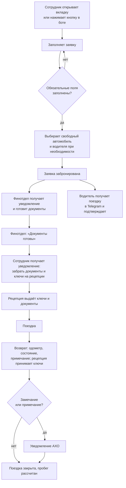
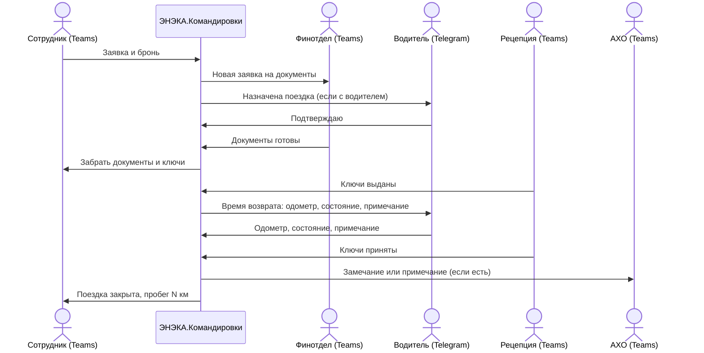
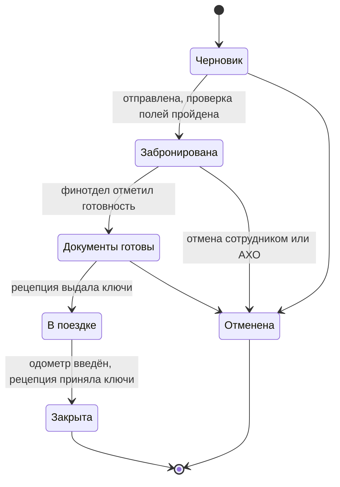
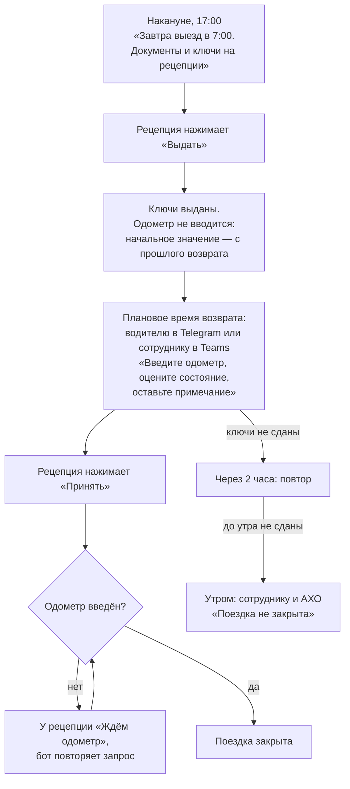
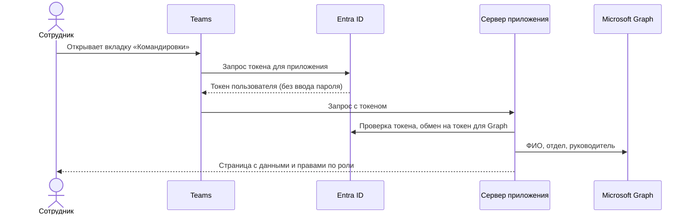
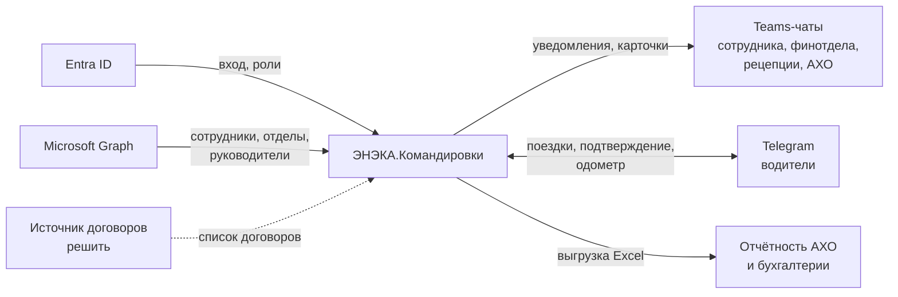
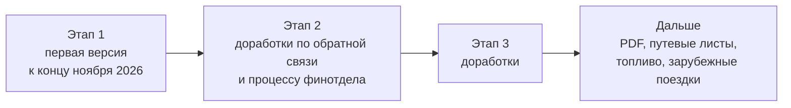

# ЭНЭКА.Командировки. Концепция версии 1

> Сервис бронирования служебных автомобилей и оформления командировок в Microsoft Teams.
> Заказчик: АХО, Дарья Шубина. Основание: ТЗ от 16.10.2026. Концепция принята, доработки по итогам обсуждения с АХО внесены (ноябрь 2026).

## Что такое ЭНЭКА.Командировки

Приложение в Microsoft Teams, которое ведёт командировку от заявки до возврата ключей. Сотрудник подаёт одну заявку, выбирает свободный автомобиль (и водителя, если нужен). Финотдел готовит документы, рецепция выдаёт и принимает ключи, а АХО видит календарь, загрузку и пробег.

Состоит из трёх частей:
- **Бот в Teams** — уведомления и кнопки действий для сотрудников, рецепции, финотдела и АХО.
- **Вкладка в Teams** — веб-страница внутри Teams: форма заявки, календарь, история, справочники.
- **Бот в Telegram** — для водителей, у которых нет Teams: уведомление о поездке, подтверждение, одометр при возврате.

Оба бота работают через общий сервер и одну базу данных.

Вход — через корпоративный аккаунт Microsoft (Entra ID), без отдельного пароля.

В основе приложения — принцип сопровождения: бот ведёт сотрудника через всю командировку до самого конца и сам подсказывает, что сделать на каждом шаге.

Открытые вопросы — в разделе «Что нужно решить».

## Какую проблему решаем

- Бронирование машин и водителей ведётся вручную, возможны накладки по датам.
- Заявка на командировку и бронь автомобиля живут отдельно, данные передаются повторно.
- Сотрудник не знает, когда готовы документы и когда идти за ключами.
- Пробег и состояние автомобиля фиксируются не всегда, сверка с отчётностью трудоёмкая.
- О неисправностях АХО узнаёт поздно.

Потери в часах пока не посчитаны.

## Что входит в первую версию

- Единая заявка: сроки, маршрут, участники, договор, цель, нужен ли водитель.
- Проверка обязательных полей до отправки.
- Показ свободных автомобилей и водителей на выбранные даты. Двойная бронь невозможна.
- Передача заявки в финотдел. Финотдел отмечает «документы готовы» вручную.
- Уведомления: сотруднику, финотделу, рецепции, АХО — в Teams; водителю — в Telegram.
- Выдача и возврат ключей и документов с подтверждением рецепции.
- Показание одометра при возврате. Начальное значение берётся с прошлого возврата. Пробег считается автоматически.
- При закрытии поездки: оценка состояния машины («Да» / «Есть замечание») и свободное примечание (мусор, забытые вещи, повреждения).
- Неисправности с уведомлением АХО.
- Отмена и перенос заявки до выдачи ключей.
- Для АХО: календарь броней, загрузка машин и водителей, история поездок с фильтрами, выгрузка в Excel.
- Справочники автомобилей и водителей, которые ведёт АХО. Отметка недоступности водителя (болезнь, отпуск).
- Telegram-бот для водителей.
- Вход через Entra ID (SSO).
- Только командировки по Беларуси.

Что не входит в первую версию:
- автоматическое формирование PDF (приказ, командировочное удостоверение) — после согласования процесса с финотделом;
- зарубежные командировки;
- путевые листы и расчёт списания топлива по нормам — после уточнения с бухгалтерией;
- интеграция с 1С и бухгалтерскими системами;
- фото одометра и повреждений;
- синхронизация с календарём Outlook.

## Роли

| Роль | Кто | Где работает | Что делает |
|---|---|---|---|
| Сотрудник | любой сотрудник компании | Teams | создаёт заявку, бронирует, при поездке без водителя вводит одометр и примечание |
| Финотдел | сотрудники финотдела (кто — уточняется) | Teams | видит новые заявки, готовит документы, отмечает «готово» |
| Рецепция | Виктория, офис-менеджер | Teams | выдаёт и принимает ключи и документы |
| Водитель | два водителя из справочника АХО | Telegram | получает поездку, подтверждает, вводит одометр и примечание при возврате |
| АХО (администратор) | Дарья Шубина | Teams | ведёт справочники, календарь, отчёты, получает примечания и сообщения о неисправностях |

Аккаунты в Teams у всех личные, общего компьютера нет.

## Как сотрудник работает с приложением

1. Заявка: сотрудник заполняет форму во вкладке. Короткий путь — кнопка «Новая поездка» в боте открывает ту же форму.
2. Бронирование: система показывает только свободные на эти даты машины и доступных водителей.
3. Документы: финотдел видит очередь заявок и отмечает готовность.
4. Выдача: рецепция отмечает выдачу ключей и документов. Одометр при выдаче не вводится.
5. Возврат: водитель (в Telegram) или сотрудник (в Teams) вводит одометр, оценивает состояние машины и при необходимости пишет примечание. Рецепция принимает ключи. Пробег считается автоматически.

## Кто и когда получает сообщения

## Статусы заявки

- Бронь машины и водителя действует со статуса «Забронирована» до «Закрыта».
- Отмена освобождает машину и водителя и уведомляет всех причастных.
- Перенос дат = новая проверка занятости. Если машина занята, система предложит другую.
- Если согласование руководителем нужно (см. «Что нужно решить»), между «Черновик» и «Забронирована» добавляется статус «На согласовании».

## Из чего состоит заявка

- Даты и время начала и окончания поездки.
- Маршрут: пункты назначения (населённые пункты Беларуси).
- Участники: выбор из сотрудников компании (справочник Entra ID).
- Договор: номер или выбор из списка (источник списка — решить).
- Цель командировки: текст.
- Нужен ли водитель: да или нет.
- Автомобиль: выбирается из свободных.
- Водитель: выбирается из свободных и доступных, если нужен.
- Автор, отдел и руководитель — подставляются автоматически из Entra ID.

Обязательные поля: все, кроме водителя (если он не нужен).

## Правила бронирования

- Автомобиль и водитель не могут быть заняты в пересекающиеся интервалы. Проверка на уровне базы данных, а не только интерфейса, поэтому двое не забронируют одну машину одновременно.
- Между поездками — буфер на подготовку автомобиля (значение задаёт АХО, например 1 час).
- Автомобиль в статусе «В ремонте» недоступен для брони.
- Водитель с отметкой «Недоступен» (болезнь, отпуск) на этот период не предлагается. Если на период уже есть брони, их авторы и АХО получают уведомление, АХО назначает другого водителя.
- Начальное показание одометра = показание при прошлом возврате этой машины. При возврате вводится текущее. Если оно меньше начального — предупреждение АХО.
- Выдать машину нельзя, пока не закрыта её предыдущая поездка.
- Закрыть поездку без показания одометра нельзя.
- Изменять и отменять бронь вне своей заявки может только АХО.

## Когда бот запрашивает данные

| Момент | Что запрашивается | У кого | Что будет, если не ввести |
|---|---|---|---|
| Создание заявки | все поля заявки | автор | заявка не отправится |
| Назначение поездки | подтверждение | водитель (Telegram) | напоминание водителю, затем сообщение АХО |
| Накануне выезда | ничего, только напоминание | сотрудник, водитель | — |
| Выдача ключей | ничего | — | начальный одометр берётся с прошлого возврата |
| Плановое время возврата | одометр, состояние («Да» / «Есть замечание»), примечание (необязательно) | водитель в Telegram, а если поездка без водителя — сотрудник в Teams | повтор через 2 часа, утром — сообщение АХО |
| Возврат ключей | — | рецепция | «Принято» недоступно, пока не введён одометр |

Как снижаем ошибки:
- Бот показывает начальное показание: «Начальное — 84 500 км. Введите текущее». Если число меньше начального, АХО получает предупреждение.
- Состояние машины — одной кнопкой «Да». При «Есть замечание» бот просит описать неисправность.
- Примечание — свободное и необязательное поле для всего остального: мусор, забытые вещи, мелкие повреждения. Уходит АХО.
- Следующую выдачу машины нельзя оформить, пока предыдущая поездка не закрыта. Поэтому начальное значение всегда известно.

Схема работает только при условии, что рецепция не выдаёт ключи без приложения (см. «Риски»).

## Принципы работы бота

Бот никогда не молчит. Человек всегда понимает, что произошло и что делать дальше. Принципы одинаковы для бота в Teams и в Telegram.

- **Ответ на каждое действие.** Нажал кнопку или отправил данные — сразу получил подтверждение: «Бронь создана», «Одометр сохранён: 85 136 км».
- **Всегда понятен следующий шаг.** Каждое сообщение заканчивается тем, что будет дальше и от кого: «Финотдел готовит документы, мы напишем, когда будут готовы».
- **Бот пишет первым.** О каждом изменении (документы готовы, бронь отменена, машина ушла в ремонт, водитель заболел) человек узнаёт от бота, а не сам проверяет вкладку.
- **Ошибки — человеческим языком.** Не «Ошибка 409», а «Эту машину только что забронировали. Свободны: Passat 5678 AB-7». С вариантом, что делать.
- **Кнопки вместо набора текста.** Где можно выбрать — даём кнопки. Текст вводится только там, где без него нельзя.
- **Один вопрос за раз.** Не просим заполнить пять полей в чате. Длинное — во вкладке, в чате — короткие шаги.
- **Ожидание тоже видно.** Если ответ сервера задерживается, бот показывает «Сохраняю…», а не тишину.
- **Карточки обновляются.** После нажатия кнопки карточка меняется («✅ Ключи выданы 05.11 06:52»), чтобы её нельзя было нажать повторно и было видно, что всё сделано.
- **Есть «Помощь».** Команда или кнопка «Помощь» объясняет, что умеет бот, и как связаться с АХО.

## Как реализуем

Своё приложение: бот и вкладка в Teams, бот в Telegram для водителей, общий сервер и база данных. Для сотрудника это одно приложение в Teams.

Как выглядит в Teams:
- В левой панели Teams — иконка «Командировки». Администратор закрепляет её всем через политику Teams.
- Внутри приложения вкладки: «Чат» (бот), «Мои поездки», «Календарь» (для АХО).
- Сообщения бота приходят в обычный список «Чаты» от отправителя «Командировки».
- Вручную приложение находится в разделе «Приложения» → «Создано для вашей организации».

Как выглядит в Telegram:
- Отдельный бот компании. Водитель подключается один раз по коду, который выдаёт АХО в справочнике водителей.
- Бот пишет водителю о поездках и принимает подтверждение и данные при возврате. Других функций у него нет.

Минус своего приложения: разработка и поддержка на нашей команде, а вход через Entra ID настраиваем сами вместе с ИТ (см. ниже).

```mermaid
flowchart LR
    subgraph Teams[Microsoft Teams]
        BOT[Бот Teams<br/>уведомления, кнопки]
        TAB[Вкладка<br/>форма, календарь, отчёты]
    end
    TG[Бот Telegram<br/>водители]
    BOT --> API[Общий сервер]
    TAB --> API
    TG --> API
    API --> DB[(База данных<br/>заявки, брони, пробег)]
    API --> GRAPH[Microsoft Graph<br/>сотрудники, отделы, руководители]
    ENTRA[Entra ID<br/>вход и роли] -.токен.-> TAB
    ENTRA -.токен.-> BOT
```

Хранение данных и выбор базы согласуем с прицелом на будущую общую систему приложений компании. Технические решения отправляем на согласование Павлу Соколову.

## Вход через Entra ID (SSO)

Сотрудник уже вошёл в Teams корпоративным аккаунтом. Приложение использует этот вход, и повторно вводить логин не нужно.

Проект — первая проверка входа через Entra ID в компании. Если он себя оправдает, такой вход могут ввести во всех приложениях компании. Поэтому настройку (регистрация, роли, права) документируем так, чтобы её можно было повторить.

Что нужно настроить:
- Регистрация приложения в Entra ID (делает администратор тенанта).
- Согласие администратора (admin consent) на чтение профилей сотрудников через Microsoft Graph.
- Роли: АХО, Финотдел, Рецепция. Права в приложении — по роли.
- Регистрация бота в Azure Bot Service (канал Teams).
- Публикация приложения в каталоге Teams организации и автоматическая установка всем сотрудникам через политику Teams. Без установки бот не сможет написать сотруднику первым.

Водители через Entra ID не входят. Они работают только в Telegram-боте и привязываются к справочнику по коду от АХО.

Что даёт Entra ID:
- Вход без пароля и без отдельной учётной записи.
- Актуальные ФИО, отдел, должность, руководитель.
- Уволенный сотрудник теряет доступ автоматически.
- Роли управляются централизованно, а не в каждом приложении.

## С чем связано приложение

- Entra ID: вход и роли.
- Microsoft Graph: справочник сотрудников для поля «Участники», отдел и руководитель автора.
- Teams: уведомления и кнопки в личном чате с ботом.
- Telegram: бот для водителей. В Telegram передаём только нужное водителю: даты, маршрут, машина, пассажиры.
- Источник договоров: в версии 1 — ручной ввод или список, который ведёт АХО. Интеграция с учётной системой — после решения.

## Нужен ли ИИ

В версии 1 — нет.

- Все данные структурные: даты, машины, водители, километры. Правила бронирования однозначны, и ИИ в них ничего не решает.
- ИИ добавляет стоимость, риск ошибок и вопрос о передаче данных во внешний сервис.
- Возможное применение в будущем: заявка свободным текстом («еду в Гомель 5–6 ноября с Ивановым по договору 123»), а бот заполняет поля и просит подтвердить. Это удобно, но не обязательно. Вернуться к вопросу по итогам пилота, если заполнение формы окажется узким местом.

## Отчёты для АХО

- Календарь: все брони по машинам и водителям, день, неделя, месяц. Недоступность водителей и ремонт машин видны в календаре.
- Загрузка: доля занятых дней по каждой машине и водителю за период.
- История поездок: кто, когда, куда, с водителем или без, пробег. Фильтры по периоду, машине, сотруднику, отделу.
- Неисправности и примечания: список по машинам, отметка «исправлено».
- Выгрузка в Excel для сверки с бухгалтерией.

История хранится полностью. «За прошедший месяц» из ТЗ — фильтр по умолчанию.

## Как поймём, что работает

- Доля поездок на служебных машинах, оформленных через приложение (цель — все).
- Количество двойных броней и накладок (цель — ноль).
- Время от заявки до «Документы готовы».
- Доля поездок, закрытых в день возврата.
- Время от сообщения о неисправности до отметки «исправлено».
- Загрузка автомобилей и водителей.
- Опрос сотрудников, финотдела, рецепции и водителей через месяц работы.

Целевые значения задаём после первого месяца.

## Кто делает

- Дмитрий Хуцишвили: руководитель проекта.
- Александра Бирило: анализ и разработка.
- Павел Соколов: согласование и приоритеты в отделе ИИ, согласование технических решений.
- Дарья Шубина (АХО): заказчик, процесс, справочники машин и водителей.

## Этапы работ

1. Этап 1 — первая рабочая версия к концу ноября 2026. Состав, экраны, карточки ботов и порядок работ — в отдельном документе «ЭНЭКА.Командировки. Этап 1».
2. Этап 2 — доработки по обратной связи первых пользователей и по итогам согласования процесса финотдела.
3. Этап 3 — доработки.

Сроки этапов 2 и 3 назовём после запуска этапа 1.

## Риски и что с ними делаем

- **Сотрудники берут ключи в обход приложения.** Правило рецепции: ключи выдаются только по заявке в приложении.
- **Задержка со стороны ИТ** (регистрация в Entra, admin consent, публикация в Teams). Заявку в ИТ подаём в первые дни этапа 1.
- **Процесс финотдела ещё обсуждается.** В этапе 1 финотдел только отмечает готовность документов. Изменения процесса — в этапах 2–3.
- **Сжатые сроки этапа 1.** В плане этапа 1 задачи разделены на обязательные и желательные. Желательные при нехватке времени переносим в этап 2.
- **Бот не может написать сотруднику**, если у того не установлено приложение. Решение: автоустановка всем через политику Teams.
- **Водитель не подключился к Telegram-боту или сменил телефон.** АХО видит статус подключения в справочнике и выдаёт новый код. Пока водитель не подключён, его сообщения дублируются АХО.
- **Ошибки в одометре.** Если показание при возврате меньше начального — предупреждение АХО.
- **Сотрудники забывают вносить данные.** Поездку нельзя закрыть без одометра, следующую выдачу машины нельзя оформить без закрытия прошлой. Плюс напоминания бота (см. «Когда бот запрашивает данные»).
- **Расширение объёма** (топливо, 1С, зарубежные поездки). В версию 1 не берём.

## Что нужно решить

1. Нужно ли согласование командировки руководителем перед бронированием.
2. Все ли командировки идут на служебной машине, или приложение оформляет и поездки без машины (поезд, личный автомобиль).
3. Процесс финотдела: какие документы, кто готовит, сроки. Нужен ли путевой лист для списания топлива и кто его оформляет. Обсуждает Дарья Шубина.
4. Кто от финотдела работает в приложении.
5. Источник списка договоров: ручной ввод, справочник АХО или учётная система.
6. Буфер между поездками и минимальный срок подачи заявки до выезда.
7. Где хранить данные и какую базу использовать — с прицелом на будущую общую систему приложений компании. Согласовать с Павлом Соколовым.
8. Можно ли передавать данные поездок водителям через Telegram (даты, маршрут, машина, пассажиры). Согласовать с Павлом Соколовым.
9. Кто в ИТ регистрирует приложение в Entra ID и публикует его в Teams.
10. Оценка текущих потерь в часах (сколько времени уходит на бронирование и сверку сейчас).
